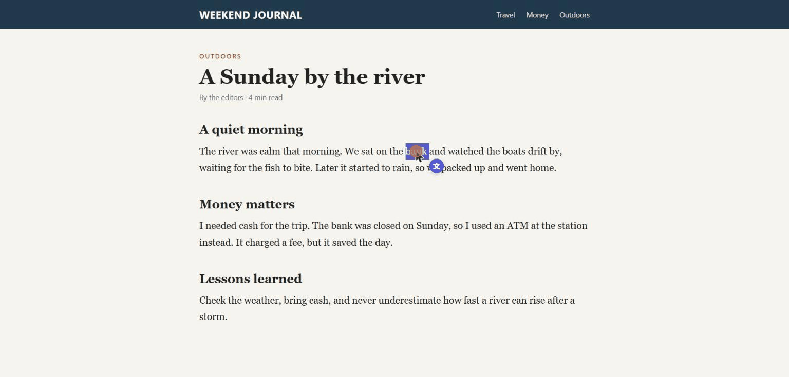

<div align="center">


# Context Translator

**Translate what you select — with the meaning the page actually intends.**

A browser extension that sends your selection *together with its surrounding context* to an AI model, so "bank" becomes *river bank* next to a river and *bank* next to an ATM.

[](LICENSE)




</div>

## Why?
The classic "Translate selection" feature translates words **in isolation**. It can't know which "bank" you mean, who "it" refers to, or that "cell" is biology on this page and prison on another.

Context Translator includes the neighboring sentences, the paragraph, the page title and the section heading in the request, and asks the model to translate **only your selection** in that context. You also get a short note explaining what the context changed, plus alternatives.

## Features
- 🎯 **Context-aware**: word sense, pronouns, gender/number, register and jargon resolved from the page
- 🖱️ **Two ways to translate**: the floating 文 icon next to your selection, or right-click → *Translate "…" with context*
- 💡 **Explains itself**: a one-line note on how context shaped the translation, plus alternative translations
- 🌍 **Language picker in the popup**, and automatic fallback to a secondary language when the text is already in your language
- 🔌 **Bring your own model**: Gemini (free), Ollama (local), Claude, ChatGPT, or any OpenAI-compatible server
- 🛟 **Resilient**: retries and switches to another Gemini model when one is overloaded or slow
- 🔒 **Private**: no account, no tracking, no servers of ours — see [PRIVACY.md](PRIVACY.md)
- 🌓 Dark mode, works in text fields, isolated UI (Shadow DOM) that doesn't break page styles

## Supported providers
| Provider | API key | Notes |
|---|---|---|
| **Gemini** (Google) | free | No credit card — [get a key](https://aistudio.google.com/app/apikey). Default model `gemini-flash-lite-latest` |
| **Ollama** (local) | none | `http://localhost:11434` — nothing leaves your computer |
| **Claude** (Anthropic) | paid | `claude-haiku-5-5` by default |
| **ChatGPT** (OpenAI) | paid | `gpt-4o-mini` by default |
| **OpenAI-compatible** | optional | LM Studio, OpenRouter, Mistral, Groq, vLLM… (base URL ending in `/v1`) |

## Install
> Store listings (Chrome Web Store, Firefox Add-ons, Edge Add-ons) are coming soon. Until then, install from source — it takes 30 seconds.

1. Download the latest ZIP from [Releases](https://github.com/mdpinto111/context-translator/releases) and unzip it (or `git clone` this repo).
2. **Chrome / Edge / Brave / Opera:** open `chrome://extensions` → enable *Developer mode* → *Load unpacked* → select the folder.
   **Firefox:** open `about:debugging#/runtime/this-firefox` → *Load Temporary Add-on* → select `manifest.json`.
3. The options page opens. Pick a provider, paste your key, click *Test connection*, then *Save*.

### Free setup with Gemini
1. Create a key at https://aistudio.google.com/app/apikey (free, no credit card).
2. In the options choose *Gemini (Google)* and paste the key — the models available to your key load automatically.
3. *Save*. Done.

> On Google's free tier, requests may be used to improve Google's models. Use Ollama if that matters to you.

### 100% local with Ollama
```bash
ollama pull llama3.1
# if the extension gets a 403, allow extension origins:
OLLAMA_ORIGINS="chrome-extension://*,moz-extension://*" ollama serve
```
Then choose *Ollama (local)* in the options.

## Usage
Select a word or sentence → click the 文 icon (or right-click → *Translate "…" with context*). The popup shows the translation, the context note, alternatives, a *Copy* button and a target-language picker. Press `Esc` to close it.

## Privacy
Text is sent **only when you request a translation**, and **only to the provider you selected**: the selection, a short excerpt around it (≤ ~2,000 characters), the page title and section heading. Settings and your API key stay in your browser. Full policy: [PRIVACY.md](PRIVACY.md).

## Development
No build step, no dependencies — plain JavaScript (Manifest V3).

```bash
node --test test/          # unit tests
node scripts/build.mjs     # store-ready ZIP in dist/
```

| File | Role |
|---|---|
| `src/context.js` | Context extraction (sentence splitting with `Intl.Segmenter`, ~2,000 chars max) |
| `src/prompt.js` | Prompt building and JSON response parsing |
| `src/providers.js` | Provider adapters, retries, Gemini model fallback |
| `src/background.js` | Context menu, model calls, cache |
| `src/content.js` | Floating icon and popup (Shadow DOM) |
| `options/` | Settings page |
| `test/page.html`, `docs/demo.html` | Manual test / demo pages |

## Contributing
Issues and pull requests are welcome! Ideas on the roadmap:
- Keyboard shortcut to translate the selection
- Translation history
- Text-to-speech pronunciation
- Built-in Chrome AI (Gemini Nano) provider

## Limitations
Doesn't run in the built-in PDF viewer or on internal pages (`chrome://`, `about:`, the Web Store). API keys are stored unencrypted in the extension's local storage.

## License
[MIT](LICENSE)
